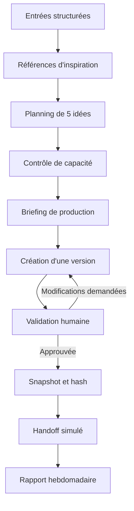
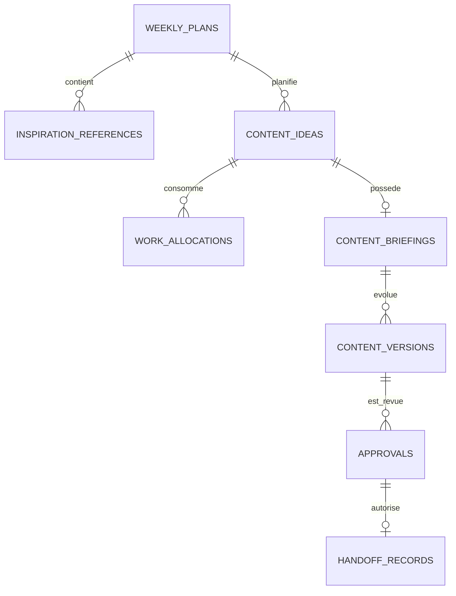
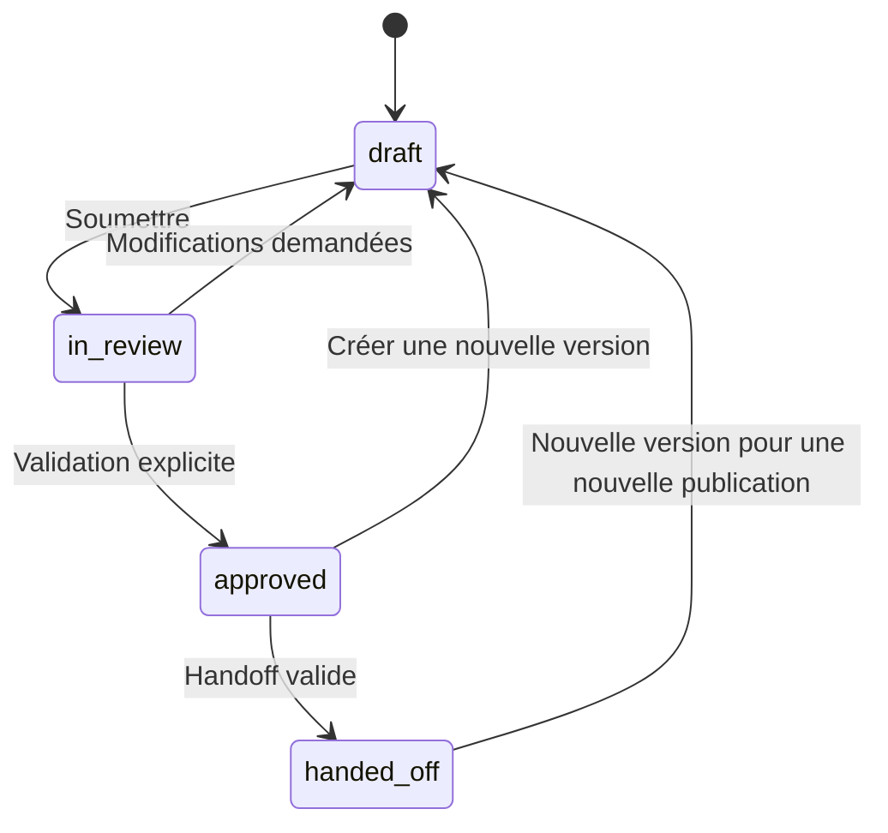
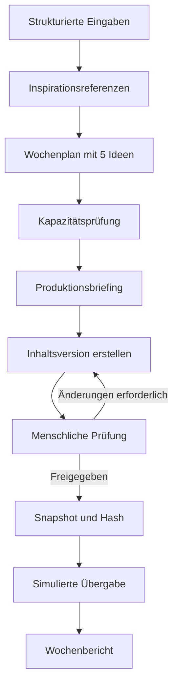
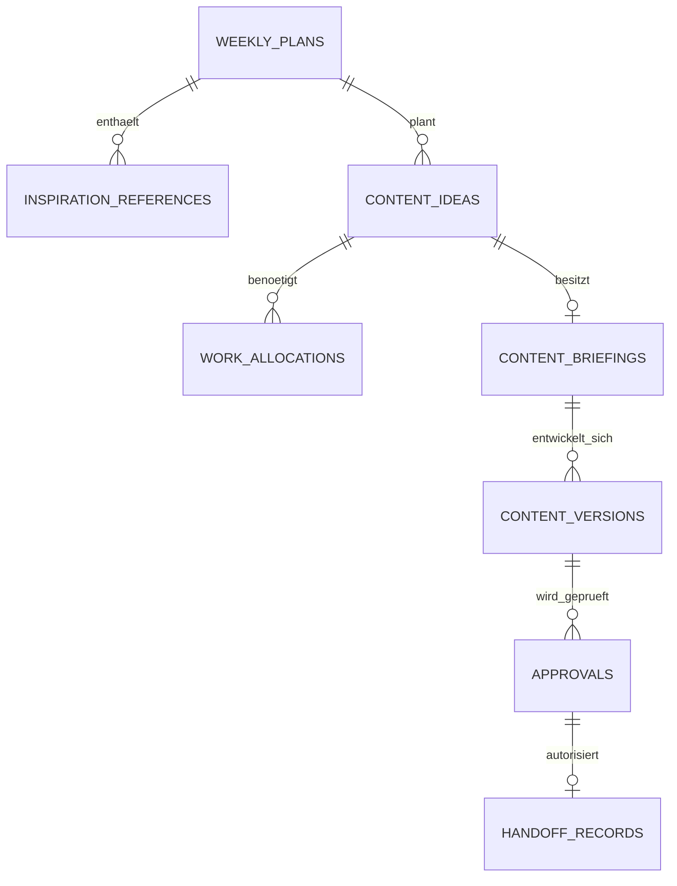
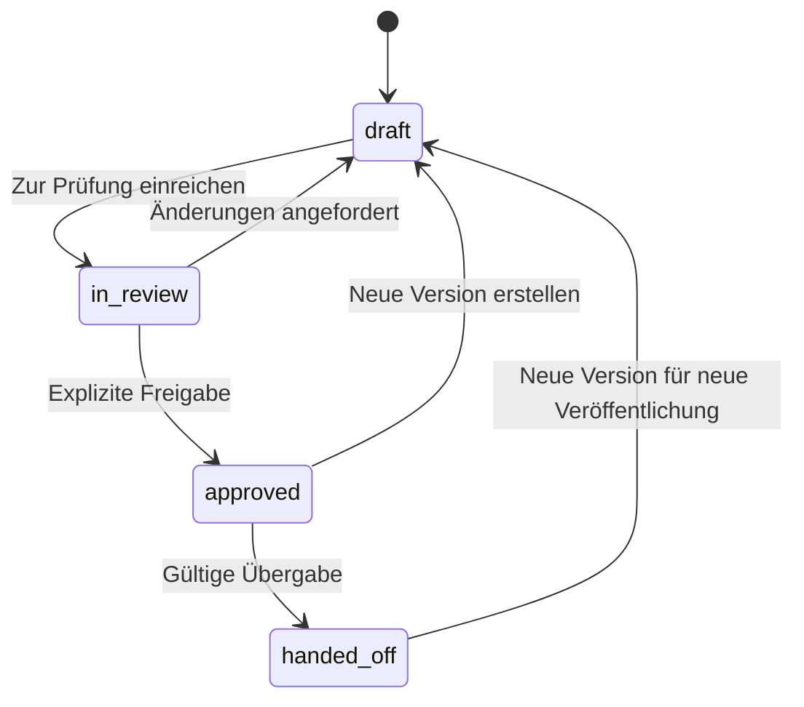

# Architecture et décisions techniques / Architektur und technische Entscheidungen

> **Projet :** KI Social Media  
> **Version du document :** conception initiale du MVP  
> **Langues :** français et allemand  
> **Contrainte impérative :** quatre heures au maximum, documentation et tests compris.

Ce document décrit l'architecture cible, le modèle de données, les règles métier et les raisons des choix. Il constitue une décision de conception pour le MVP, pas une affirmation que toutes les fonctions sont déjà implémentées.

## État réel de l'implémentation / État vérifié

Cette section distingue les fonctions présentes dans le dépôt des éléments qui restent une conception ou une simulation.

| Domaine | État |
|---|---|
| Génération IA simulée du planning (3 priorités + 2 réserves) | Contrat, mock déterministe, orchestration, validation et tests présents |
| Inspirations synthétiques | Modèle, migration et tests présents |
| Affectations et capacité | Modèles, service et tests présents |
| Génération IA simulée du briefing et des variantes par canal | Contrat, mock déterministe, persistance, version et tests présents |
| Versions immuables et hash SHA-256 | Service, modèle et tests présents |
| Validation humaine | Service, historique des décisions et tests présents |
| Handoff | Service simulé, payload JSON persistant, idempotence et tests présents |
| Rapport hebdomadaire TXT | Génération depuis la base et export sur le disque local, tests présents |
| Publication sur les réseaux sociaux | Non implémentée ; aucune publication réelle |
| Inspirations / métriques en direct | Non implémentées ; données de démonstration synthétiques |

Le nom `content_version_approvals` correspond à l'historique des validations et `content_handoff_records` aux transmissions simulées. Le rapport est un fichier texte généré par `WeeklyReportGenerator`, pas une statistique codée en dur.

### Schéma réellement persisté dans le MVP

Les listes de champs des sections suivantes décrivent le modèle de conception envisagé. Elles ne constituent pas toutes le schéma SQL livré. Les champs effectivement utilisés par les modèles Eloquent du dépôt sont :

| Table | Champs métier persistés |
|---|---|
| `weekly_plans` | `week_start`, `seasonal_occasion`, `input_data`, `capacity_limits`, `status` |
| `inspiration_references` | `weekly_plan_id`, `channel`, `source_id`, `description`, `metrics` |
| `content_ideas` | `weekly_plan_id`, `title`, `topic`, `target_audience`, `channels`, `format`, `priority_type`, `selection_reason`, `responsible_person`, `planned_at`, `estimated_minutes`, `status` |
| `work_allocations` | `content_idea_id`, `person_key`, `work_type`, `estimated_minutes` |
| `content_briefings` | `content_idea_id`, `hook`, `body`, `filming_plan`, `on_screen_text`, `cover_idea`, `cta_text`, `appointment_url`, `status` |
| `content_versions` | `content_briefing_id`, `version_number`, `snapshot`, `media_reference`, `channels`, `scheduled_at`, `content_hash`, `status` |
| `content_version_approvals` | `content_version_id`, `reviewer`, `decision`, `content_hash`, `comment`, `reviewed_at` |
| `content_handoff_records` | `content_version_id`, `content_version_approval_id`, `idempotency_key`, `payload`, `status`, `handed_off_at` |

Les clés primaires, clés étrangères, contraintes uniques et timestamps sont définis dans les migrations. En particulier, le snapshot JSON de `content_versions` contient le contenu et les variantes par canal ; les approbations conservent la décision, le hash approuvé et les informations du réviseur. Il n'existe pas de colonne séparée `snapshot` dans la table des approbations.

Le service de capacité calcule la charge et émet des avertissements. Il ne choisit pas automatiquement une nouvelle affectation et ne propose pas encore de replanification automatisée : toute adaptation reste une décision humaine.

### Tatsächlicher Implementierungsstand

Die Tabelle oben zeigt den überprüften Implementierungsstand. Die deterministische KI-Mock-Generierung für Wochenideen und Briefings, Kapazitätsberechnung, unveränderliche Versionen, menschliche Freigabe, idempotente simulierte Übergabe und TXT-Wochenbericht sind im Repository implementiert. Der Mock verwendet feste Testantworten mit begrenzten kontextbezogenen Textanpassungen; es gibt keinen echten LLM-Aufruf und keinen Netzwerkzugriff. Reale Social-Media-Veröffentlichungen sowie Live-Trend- und Performance-Daten sind ausdrücklich nicht implementiert. Alle Demo-Referenzen und Medienkennungen sind synthetisch.

---

# Partie I — Français

## 1. Compréhension du besoin

Le projet ne consiste pas simplement à générer des textes pour les réseaux sociaux. Il doit démontrer un workflow éditorial complet, compréhensible et contrôlé par un humain :

1. recevoir des informations structurées et des inspirations ;
2. construire un planning hebdomadaire de cinq idées ;
3. sélectionner trois priorités et conserver deux idées en réserve ;
4. vérifier la capacité de travail des personnes ;
5. produire un briefing détaillé pour une priorité ;
6. générer et conserver des versions du contenu et des variantes par canal ;
7. demander une validation humaine explicite ;
8. transmettre uniquement une version approuvée à une interface de publication simulée ;
9. produire un rapport hebdomadaire à partir des données réellement enregistrées.

Aucune publication réelle sur Instagram, Facebook, TikTok ou LinkedIn n'est réalisée. Les données de démonstration sont fictives. Les sources d'inspiration sont simulées et ne doivent pas être présentées comme des tendances confirmées sans preuve.

## 2. Contraintes et périmètre

### 2.1 Contrainte de temps

Le temps total disponible est de **4 heures (240 minutes), documentation et tests compris**. Cette limite est stricte. Si une partie prend plus de temps que prévu, il faut réduire les éléments facultatifs et préserver le workflow principal. Le temps réellement passé doit être indiqué honnêtement dans la livraison.

### 2.2 Capacités de l'équipe

| Personne fictive | Capacité hebdomadaire |
|---|---:|
| Personne A | 90 minutes |
| Personne B | 150 minutes |
| **Total** | **240 minutes** |

Ces minutes couvrent la production média, les variantes par canal, la coordination et la validation. Il ne faut pas confondre cette capacité de production éditoriale avec la disponibilité de rendez-vous de consultation chez l'opticien.

### 2.3 Inclus dans le MVP

- Planning hebdomadaire contenant exactement cinq idées : trois priorités et deux réserves.
- Au moins trois références d'inspiration simulées, avec canal et identifiant de source.
- Justification de la sélection des priorités.
- Affectation des tâches et calcul de charge par personne.
- Avertissement explicite en cas de dépassement de capacité.
- Un briefing complet pour une idée prioritaire.
- Variantes de contenu adaptées aux canaux choisis.
- Versions immuables du contenu.
- Validation humaine liée à une version précise.
- Transmission simulée avec protection contre les doublons.
- Rapport hebdomadaire textuel.
- Tests automatisés des règles critiques.

### 2.4 Hors périmètre

- Publication réelle et connexion OAuth aux réseaux sociaux.
- Création ou stockage réel de photos et vidéos.
- Recherche web ou scraping de tendances en direct.
- Envoi réel d'e-mails.
- Tableau de bord analytique complet.
- Calculs économiques ou ROI sans données suffisantes.
- Réponses automatiques aux commentaires.
- Hébergement de production, Kubernetes ou architecture microservices.
- Système complet de comptes, rôles et permissions.

Ces sujets peuvent être décrits comme évolutions futures, mais ne doivent pas être présentés comme implémentés.

## 3. Workflow fonctionnel



Le rapport hebdomadaire lit les données enregistrées dans le planning, les allocations, les versions, les validations et les handoffs. Il ne doit pas générer indépendamment des chiffres ou des statuts qui ne correspondent pas à la base de données.

## 4. Architecture applicative

### 4.1 Choix : monolithe Laravel

Le MVP utilise une seule application Laravel avec MySQL et Blade.

**Pourquoi ce choix ?**

- Laravel fournit le routage HTTP, la validation, l'injection de dépendances, les migrations et Eloquent.
- Eloquent simplifie la persistance relationnelle pour un petit domaine métier.
- Blade permet une interface serveur simple sans application frontend séparée.
- Le conteneur Laravel permet de remplacer facilement un générateur IA simulé par un fournisseur réel ultérieurement.
- Un monolithe est plus rapide à comprendre, tester et exécuter dans une limite de quatre heures.
- Les règles métier restent dans des services dédiés et ne sont pas dispersées dans les contrôleurs.

Un framework est choisi pour éviter de réimplémenter des mécanismes techniques standards. La valeur du projet se trouve dans les règles métier, la traçabilité, la validation et la sécurité du handoff.

### 4.2 Pourquoi pas des microservices ou n8n ?

Le workflow est limité, local et ne nécessite pas de déploiement indépendant de composants. Des microservices introduiraient des appels réseau, de la configuration, de l'observabilité et des problèmes de cohérence distribuée sans bénéfice proportionné.

n8n pourrait être pertinent pour orchestrer des intégrations externes dans une évolution future. Pour ce MVP, il ajouterait un second système à configurer et à expliquer alors que l'objectif est de démontrer les règles métier dans le backend Laravel.

### 4.3 Organisation du code visée

Structure indicative, à adapter aux conventions Laravel et à la taille réelle du code :

```text
app/
  DTO/
  Enums/
  Http/
    Controllers/
    Requests/
    Resources/
  Models/
  Services/
    AI/
    Planning/
    Capacity/
    Content/
    Review/
    Handoff/
    Reporting/
  Workflow/
database/
  migrations/
  seeders/
resources/
  views/
tests/
  Feature/
  Unit/
storage/
  app/
    demo/
    reports/
```

Principes :

- Contrôleurs minces : HTTP, validation d'entrée et délégation aux services.
- DTO immuables et typés (`readonly`) pour transporter les données validées entre les couches : planning, idées, inspirations, affectations, briefings, versions et provenance IA. La validation Laravel reste à la frontière ; les DTO représentent ensuite les données fiables utilisées par la persistance.
- Services focalisés sur une responsabilité métier.
- Enums pour les états et types stables.
- Eloquent pour l'accès aux données ; pas de repository générique ajouté sans besoin concret.
- Tests unitaires pour les calculs et règles isolées ; tests Feature pour les parcours HTTP et les règles de workflow.
- Pas de couches vides ni d'abstractions ajoutées uniquement pour donner une impression de complexité.

## 5. Modèle de données relationnel

Le modèle métier initial comprend **huit tables**. Il cherche un équilibre entre traçabilité et rapidité d'implémentation.

### 5.1 Vue d'ensemble des relations



### 5.2 Table `weekly_plans`

**Rôle :** représenter une semaine éditoriale et conserver le contexte utilisé pour construire le planning.

Champs proposés :

- `id`
- `week_start` : date de début de semaine.
- `seasonal_occasion` : événement ou contexte saisonnier.
- `input_data` : JSON contenant les données structurées d'entrée.
- `capacity_limits` : JSON contenant les limites de capacité de l'équipe.
- `status`
- timestamps.

**Pourquoi conserver les entrées en JSON ?**

Le format d'entrée peut évoluer et contient plusieurs paramètres de contexte. Le conserver permet de retrouver les hypothèses utilisées lors de la génération du planning. Les informations qui nécessitent des relations ou des recherches indépendantes, comme les inspirations, restent dans leurs propres tables.

### 5.3 Table `inspiration_references`

**Rôle :** conserver la provenance des inspirations utilisées pour la planification.

Champs proposés :

- `id`
- `weekly_plan_id`
- `channel`
- `source_id` : identifiant fictif de la source.
- `observation`
- `evidence_status` : par exemple `unverified`, `supported`, `unknown`.
- `metrics` : JSON nullable.
- timestamps.

**Décision importante :** une inspiration n'est pas une preuve de tendance. Les métriques absentes restent inconnues (`null` ou statut `unknown`) ; elles ne sont pas remplacées par zéro. Le MVP n'effectue aucune recherche en direct.

### 5.4 Table `content_ideas`

**Rôle :** stocker les cinq idées du planning et leur décision éditoriale.

Champs proposés :

- `id`
- `weekly_plan_id`
- `public_id` : identifiant lisible pour la démonstration.
- `topic`
- `target_audience`
- `tone`
- `format`
- `target_channels` : JSON des canaux visés.
- `assigned_person` : code fictif, par exemple `A` ou `B`.
- `scheduled_at`
- `selection_type` : `priority` ou `reserve`.
- `selection_reason` : justification de la sélection.
- `planning_status` : état de planification, distinct du cycle de validation.
- timestamps.

**Pourquoi ne pas créer une table de collaborateurs ?**

Le sujet ne prévoit que deux personnes fictives et aucun système d'identité ou de permission. Des codes `A` et `B` suffisent pour calculer la capacité. Une table de collaborateurs serait justifiée si l'on ajoutait des profils, des compétences, des absences ou des utilisateurs réels.

**Invariant :** chaque planning contient exactement cinq idées, dont trois priorités et deux réserves. Cette règle est vérifiée par le service de planification et par les tests ; une contrainte SQL simple ne suffit pas à exprimer un comptage agrégé sur plusieurs lignes.

### 5.5 Table `work_allocations`

**Rôle :** détailler le temps consommé par chaque idée et chaque personne.

Champs proposés :

- `id`
- `content_idea_id`
- `person_code`
- `task_type` : `production`, `channel_variants`, `coordination`, `approval`.
- `estimated_minutes`
- timestamps.

**Pourquoi une table séparée ?**

Un total par publication ne suffit pas à expliquer la charge. Les allocations permettent de répondre à trois questions : quelle tâche est nécessaire, qui l'effectue et combien de minutes sont prévues ? Le total par personne est calculé à partir de ces lignes et comparé à sa capacité.

Le système ne doit jamais augmenter silencieusement la capacité. En cas de dépassement, le MVP affiche l'écart. Le déplacement d'une idée, l'utilisation d'une réserve, la réaffectation d'une tâche ou la réduction du périmètre restent des décisions humaines ; aucune alternative n'est calculée automatiquement.

### 5.6 Table `content_briefings`

**Rôle :** conserver les instructions de production destinées à l'équipe.

Champs proposés :

- `id`
- `content_idea_id` (unique)
- `filming_plan`
- `on_screen_text`
- `cover_idea`
- `cta_text`
- `appointment_url`
- `status`
- timestamps.

Le briefing contient les instructions de tournage ou de conception, le texte à afficher, l'idée de couverture et l'appel à la prise de rendez-vous. L'URL de démonstration doit utiliser un domaine fictif, par exemple `example.com`.

### 5.7 Table `content_versions`

**Rôle :** représenter chaque version immuable du contenu.

Champs proposés :

- `id`
- `content_briefing_id`
- `version_number`
- `hook`
- `body`
- `media_reference`
- `channels` : JSON.
- `channel_variants` : JSON.
- `scheduled_at`
- `generation_provider`
- `is_simulated`
- timestamps.

**Pourquoi conserver les variantes en JSON ?**

Chaque réseau social peut avoir un texte, un format ou des hashtags différents. Un JSON validé permet de conserver ces variantes dans une seule version cohérente. Pour cinq idées et un seul briefing complet, une table supplémentaire pour chaque variante ajouterait de la complexité sans apporter suffisamment de valeur. Si les variantes deviennent des objets gérés indépendamment, une table dédiée sera préférable.

**Règle d'immutabilité :** une version déjà créée n'est pas écrasée lorsqu'un contenu change. Une modification significative crée une nouvelle version avec un numéro supérieur. Les versions précédentes restent consultables.

La référence média est une chaîne ou un identifiant fictif, pas un fichier média réellement stocké. `is_simulated` et `generation_provider` rendent visible le caractère simulé du résultat.

### 5.8 Table `approvals`

**Rôle :** conserver les décisions humaines et la preuve du contenu exact qui a été approuvé.

Champs proposés :

- `id`
- `content_version_id`
- `decision` : `approved` ou `changes_requested`.
- `approved_by` : identifiant fictif du validateur.
- `snapshot` : JSON canonique des champs approuvés.
- `snapshot_hash` : empreinte SHA-256 du snapshot.
- `reviewed_at`
- timestamps.

**Pourquoi un snapshot et un hash ?**

Une simple colonne `approved = true` ne permet pas de savoir ce qui a été approuvé. Le snapshot conserve le texte, la référence média, les canaux, les variantes et la date de publication. Le hash permet de détecter une différence entre le contenu présenté au handoff et le contenu validé.

L'approbation est liée à un `content_version_id` précis. Une nouvelle version exige une nouvelle validation. Les anciennes approbations restent dans l'historique et ne valident pas automatiquement la version suivante.

### 5.9 Table `handoff_records`

**Rôle :** conserver le résultat de la transmission vers l'interface de publication simulée.

Champs proposés :

- `id`
- `approval_id`
- `content_version_id`
- `idempotency_key` (unique).
- `payload` : JSON envoyé à l'interface simulée.
- `status` : `handed_off` ou `failed` (éventuellement `prepared` si le flux le nécessite).
- `handed_off_at`
- `error_message`
- timestamps.

**Pourquoi stocker le payload ?**

Il rend la démonstration vérifiable : on peut inspecter exactement ce qui aurait été transmis, sans appeler de réseau social réel.

**Protection contre les doublons :**

- La clé d'idempotence est déterministe pour une version et une opération de handoff.
- Une contrainte unique en base protège contre deux requêtes concurrentes utilisant la même clé.
- Une contrainte unique sur `content_version_id` protège également contre un second handoff de la même version avec une clé différente.
- Le service vérifie l'approbation et le hash avant de créer le record.
- Le même appel répété retourne le résultat existant au lieu de créer un nouveau handoff.

## 6. Pourquoi ne pas créer plus de tables ?

| Élément envisagé | Décision | Justification |
|---|---|---|
| Collaborateurs | Pas de table pour le MVP | Deux personnes fictives identifiées par A et B suffisent. |
| Médias | Pas de table | Le sujet demande une référence de média, pas un système de fichiers. |
| Variantes par canal | JSON dans la version | Modèle compact adapté au faible volume du MVP. |
| Rapports | Pas de table | Le rapport est généré à partir des données persistées. |
| Historique d'approbation | Table dédiée | La validation est une preuve métier importante. |
| Handoff | Table dédiée | Nécessaire pour l'idempotence, le payload et le résultat. |

La simplicité ne signifie pas supprimer la traçabilité. Les tables séparées sont conservées là où elles protègent une règle métier ou représentent un historique important.

## 7. Cycle de vie et transitions autorisées

Les états obligatoires du contenu sont :

- `draft` : brouillon en cours de préparation.
- `in_review` : soumis à la vérification humaine.
- `approved` : version exacte approuvée.
- `handed_off` : version transmise à l'interface simulée.

Transitions principales :



Les transitions sont pilotées par un service de workflow, pas par des changements de statut arbitraires dans les contrôleurs. Un handoff en échec ne doit jamais être présenté comme une publication réussie. Le statut `handed_off` signifie uniquement que le transfert simulé a réussi, pas que le réseau social a publié le contenu.

## 8. Règles métier et invariants

1. Un planning comporte exactement cinq idées : trois priorités et deux réserves.
2. Chaque idée a au moins un canal cible, un responsable et une date planifiée lorsqu'elle est sélectionnée pour exécution.
3. Au moins trois références d'inspiration sont présentes dans les données de démonstration.
4. Les métriques absentes restent inconnues ; aucune valeur n'est inventée.
5. Les estimations de travail sont détaillées par tâche et par personne.
6. La charge totale de A ne dépasse pas 90 minutes sans avertissement explicite ; celle de B ne dépasse pas 150 minutes sans avertissement explicite.
7. Le contenu doit avoir une référence média avant le handoff.
8. Le contenu doit être explicitement approuvé avant le handoff.
9. L'approbation doit correspondre à la version, au texte, aux variantes, aux canaux, au média et au calendrier transmis.
10. Toute modification de ces champs crée une nouvelle version et nécessite une nouvelle approbation.
11. Une même version ne peut être transmise qu'une fois.
12. Une erreur de handoff ne devient jamais un succès par défaut.
13. Le rapport est construit à partir des données réellement enregistrées.

## 9. Snapshot et calcul du hash

Le snapshot contient au minimum :

- identifiant et numéro de version ;
- hook et texte principal ;
- référence média ;
- canaux ciblés ;
- toutes les variantes de canal ;
- date et heure planifiées ;
- CTA et URL de rendez-vous si ces éléments font partie du contenu transmis.

Pour obtenir un hash reproductible, le snapshot doit être normalisé avant calcul : mêmes clés, ordre stable des clés, représentation cohérente des dates et absence de champs volatils comme `updated_at`.

Exemple conceptuel :

```php
$snapshot = $snapshotFactory->fromVersion($version);
$canonicalJson = $canonicalizer->encode($snapshot);
$hash = hash('sha256', $canonicalJson);
```

Le code ci-dessus illustre le principe ; il ne suppose pas qu'un service de canonicalisation existe déjà. Pour un MVP, une fonction dédiée qui trie récursivement les clés JSON peut suffire.

Avant le handoff, le système reconstruit le snapshot de la version et compare son hash au hash approuvé. Si les valeurs ne correspondent pas, la transmission est bloquée.

## 10. Handoff transactionnel et idempotent

Le handoff doit être exécuté côté serveur dans une transaction de base de données :

1. charger la version et l'approbation ;
2. vérifier que la décision est `approved` ;
3. vérifier que la version possède une référence média ;
4. recalculer et comparer le hash ;
5. vérifier que les champs obligatoires et les canaux sont valides ;
6. construire le payload simulé ;
7. créer le record avec sa clé d'idempotence ;
8. marquer le workflow `handed_off` uniquement après la création réussie du record.

En cas de répétition, le service recherche le handoff existant et le retourne. La contrainte unique en base reste la dernière protection contre les requêtes concurrentes.

Aucun appel externe n'est effectué. Si une vraie intégration est ajoutée plus tard, il faudra gérer les erreurs réseau, les délais d'attente, les reprises et la différence entre « requête envoyée » et « publication confirmée par la plateforme ».

## 11. Capacité et planification

La capacité est calculée à partir des allocations :

```text
charge(Personne) = somme des minutes allouées à cette personne
marge(Personne) = capacité hebdomadaire - charge(Personne)
```

Exemple fictif :

| Personne | Capacité | Charge estimée | Marge |
|---|---:|---:|---:|
| A | 90 min | 105 min | -15 min |
| B | 150 min | 120 min | 30 min |

Dans cet exemple, le planning doit signaler un dépassement de 15 minutes pour A. Il peut proposer de déplacer une tâche réaliste vers B ou de reporter une idée en réserve, mais il ne doit jamais modifier automatiquement la capacité de A.

Les temps de production, de variantes, de coordination et de validation doivent être inclus. La disponibilité des créneaux de rendez-vous clients est un sujet différent et reste une extension/documentation.

## 12. Génération IA : abstraction et transparence

La génération est maintenant exécutée derrière `AiContentGeneratorInterface`, implémentée par `MockAiContentGenerator` et orchestrée par `AiAssistedContentWorkflow`.

- Le mock génère les cinq idées à partir du contexte structuré, puis un briefing complet et les variantes des canaux concernés.
- Les réponses sont déterministes : ce sont des réponses de test fixes avec substitutions contextuelles limitées, pas une inférence par LLM.
- La sortie est validée avant persistance par les validateurs du workflow et de `WeeklyPlanGenerator`.
- Le fournisseur `mock`, le modèle `deterministic-fixture-v1` et `simulated=true` sont conservés dans les données du planning et dans le snapshot de version.
- `AppServiceProvider` relie l'interface au mock. Un futur adaptateur OpenAI ou autre pourra remplacer ce binding sans déplacer les règles métier.
- Aucune clé API, requête réseau ou donnée réelle n'est utilisée ; les inspirations et exemples restent synthétiques.

Pourquoi cette abstraction ? Le workflow ne doit pas dépendre d'un fournisseur IA particulier. La génération est une dépendance remplaçable ; les règles métier restent sous le contrôle de l'application.

## 13. Rapport hebdomadaire

Le rapport est un fichier texte généré depuis les données enregistrées. Il doit présenter :

- la semaine et le contexte ;
- les trois priorités et les deux réserves ;
- les canaux et dates planifiés ;
- les responsables et les estimations ;
- la charge et la marge de chaque personne ;
- les avertissements de capacité ;
- le statut de validation et de handoff ;
- les limites connues et les données inconnues.

Le rapport peut être conçu pour être envoyé ultérieurement par e-mail, mais l'envoi réel n'est pas requis.

## 14. Architecture des tests et preuves attendues

Les quatre scénarios obligatoires :

| Test | Situation | Résultat attendu |
|---|---|---|
| T1 | Version complète et approuvée, handoff exécuté plusieurs fois | Un seul handoff existe. |
| T2 | Approbation absente ou référence média absente | Handoff refusé, aucun record de succès. |
| T3 | Texte ou autre champ approuvé modifié | Nouvelle version requise et nouvelle approbation obligatoire. |
| T4 | Charge supérieure à la capacité | Avertissement visible ou réorganisation justifiée. |

Tests complémentaires recommandés :

- un planning avec un nombre d'idées différent de cinq est rejeté ;
- trois priorités et deux réserves sont exigées ;
- une métrique absente reste inconnue ;
- un état ne peut pas être sauté ;
- un handoff en erreur n'affiche pas `handed_off` ;
- un payload conserve les variantes propres à chaque canal ;
- le rapport correspond aux enregistrements de la base.

Les tests doivent prouver les comportements, pas seulement appeler les méthodes. Les logs ou captures d'écran de démonstration doivent distinguer clairement ce qui est exécuté, simulé et seulement documenté.

## 15. Extensions à documenter, sans implémentation MVP

### Mesure et attribution

Prévoir des liens tagués par canal et campagne, puis suivre portée, clics, demandes attribuées, rendez-vous et achats. Un tableau de bord doit afficher les données manquantes et éviter le double comptage. Une conversion attribuée ne prouve pas à elle seule un effet causal supplémentaire.

### Économie

Le coût par demande ou par client ne peut être calculé que si les coûts et les dénominateurs sont disponibles. Le chiffre d'affaires doit être distingué de la marge contributive. Si le dénominateur est zéro ou inconnu, aucun ratio ne doit être affiché.

### Commentaires

Les réponses sont des brouillons soumis à un humain. Les plaintes, cas sensibles ou ambigus sont escaladés. Aucune réponse automatique n'est envoyée.

### Opérations

Une évolution de production pourrait utiliser un processus planifié central, des secrets protégés, des alertes d'erreur et une procédure manuelle de secours lorsque des intégrations sont indisponibles.

### Capacité

La capacité de production de contenu reste distincte de la disponibilité des rendez-vous de consultation. Ces deux plannings ne doivent pas être confondus.

## 16. Décisions synthétiques

| Décision | Motif principal |
|---|---|
| Laravel monolithique | Réduire le coût d'implémentation et de compréhension. |
| MySQL | Utiliser la base déjà configurée et tester le comportement relationnel réel. |
| Blade | Éviter un frontend séparé. |
| Huit tables métier | Préserver la traçabilité sans multiplier les entités. |
| JSON pour les variantes | Garder une version cohérente avec un schéma de données compact. |
| Versions immuables | Ne jamais réécrire l'historique approuvé. |
| Snapshot + SHA-256 | Prouver exactement ce qui a été validé. |
| Allocations de travail | Expliquer et calculer la charge par personne. |
| Mock IA | Démonstration reproductible sans dépendance externe. |
| Handoff simulé + idempotence | Démontrer une transmission sûre sans publication réelle. |
| Rapport généré depuis la base | Éviter les incohérences entre rapport et workflow. |
| Pas de microservices / n8n | Complexité disproportionnée pour quatre heures. |

---

# Teil II — Deutsch

## 1. Aufgabenverständnis

Das Projekt ist nicht nur ein Generator für Social-Media-Texte. Es soll einen vollständigen, nachvollziehbaren und menschlich kontrollierten Redaktionsprozess demonstrieren:

1. strukturierte Eingaben und Inspirationsquellen erfassen;
2. einen Wochenplan mit fünf Ideen erstellen;
3. drei Ideen als Prioritäten auswählen und zwei als Reserven behalten;
4. die verfügbare Arbeitskapazität prüfen;
5. für eine priorisierte Idee ein vollständiges Produktionsbriefing erstellen;
6. Inhaltsversionen und kanalspezifische Varianten verwalten;
7. eine ausdrückliche menschliche Freigabe einholen;
8. ausschließlich eine freigegebene Version an eine simulierte Publishing-Schnittstelle übergeben;
9. einen Wochenbericht aus den tatsächlich gespeicherten Daten erzeugen.

Es findet keine echte Veröffentlichung auf Instagram, Facebook, TikTok oder LinkedIn statt. Alle Demo-Daten sind fiktiv. Simulierte Inspirationsquellen dürfen ohne Nachweis nicht als bestätigte Trends bezeichnet werden.

## 2. Rahmenbedingungen und Umfang

### 2.1 Zeitlimit

Das gesamte Zeitbudget beträgt **maximal vier Stunden (240 Minuten), einschließlich Tests und Dokumentation**. Das Limit ist verbindlich. Wenn ein Arbeitsschritt länger dauert, werden optionale Funktionen reduziert, während der Kernworkflow funktionsfähig bleiben muss. Die tatsächlich aufgewendete Zeit wird in der Abgabe ehrlich dokumentiert.

### 2.2 Teamkapazität

| Fiktive Person | Wöchentliche Kapazität |
|---|---:|
| Person A | 90 Minuten |
| Person B | 150 Minuten |
| **Gesamt** | **240 Minuten** |

Diese Zeit umfasst Medienproduktion, Kanalvarianten, Koordination und Freigabe. Die redaktionelle Produktionskapazität ist nicht mit der Verfügbarkeit von Beratungsterminen beim Optiker gleichzusetzen.

### 2.3 Bestandteil des MVP

- Wochenplan mit genau fünf Ideen: drei Prioritäten und zwei Reserven.
- Mindestens drei simulierte Inspirationsreferenzen mit Kanal und Source-ID.
- Begründung der Auswahl.
- Aufgabenverteilung und Kapazitätsberechnung pro Person.
- Sichtbare Warnung bei Kapazitätsüberschreitung.
- Ein vollständiges Produktionsbriefing für eine priorisierte Idee.
- Kanalspezifische Inhaltsvarianten.
- Unveränderliche Inhaltsversionen.
- Menschliche Freigabe für eine konkrete Version.
- Simulierte Übergabe mit Duplikatschutz.
- Textbasierter Wochenbericht.
- Automatisierte Tests der kritischen Geschäftsregeln.

### 2.4 Nicht Bestandteil des MVP

- Echtes Publishing und OAuth-Verbindungen zu sozialen Netzwerken.
- Echte Foto- oder Videoproduktion und Mediendateiverwaltung.
- Live-Recherche oder Scraping von Trends.
- Tatsächlicher E-Mail-Versand.
- Vollständiges Analytics-Dashboard.
- Wirtschaftlichkeits- oder ROI-Berechnungen ohne ausreichende Daten.
- Automatische Kommentarantworten.
- Produktivhosting, Kubernetes oder Microservices.
- Vollständige Benutzer-, Rollen- und Rechteverwaltung.

Diese Punkte können als zukünftige Erweiterungen beschrieben werden, dürfen aber nicht als implementiert dargestellt werden.

## 3. Fachlicher Workflow



Der Wochenbericht liest die gespeicherten Planungs-, Aufgaben-, Versions-, Freigabe- und Übergabedaten. Er darf keine unabhängigen Zahlen oder Statuswerte erfinden, die nicht mit der Datenbank übereinstimmen.

## 4. Anwendungsarchitektur

### 4.1 Entscheidung: Laravel-Monolith

Das MVP wird als einzelne Laravel-Anwendung mit MySQL und Blade umgesetzt.

**Warum diese Entscheidung?**

- Laravel stellt HTTP-Routing, Validierung, Dependency Injection, Migrationen und Eloquent bereit.
- Eloquent vereinfacht die relationale Speicherung eines kleinen Fachmodells.
- Blade ermöglicht eine einfache serverseitig gerenderte Oberfläche ohne separates Frontend.
- Über den Laravel-Service-Container kann ein simulierter KI-Generator später durch einen echten Anbieter ersetzt werden.
- Ein Monolith ist innerhalb eines Zeitlimits von vier Stunden schneller zu verstehen, zu testen und auszuführen.
- Die Geschäftsregeln bleiben in fokussierten Services und werden nicht in Controllern verteilt.

Das Framework übernimmt technische Standardaufgaben. Der eigentliche fachliche Mehrwert liegt in den Geschäftsregeln, der Nachvollziehbarkeit, der Freigabe und der sicheren Übergabe.

### 4.2 Warum keine Microservices und kein n8n?

Der Workflow ist begrenzt, lokal und benötigt keine unabhängig deploybaren Komponenten. Microservices würden Netzwerkaufrufe, zusätzliche Konfiguration, Observability und Probleme verteilter Konsistenz einführen, ohne einen entsprechenden Nutzen zu liefern.

n8n kann für externe Integrationen in einer späteren Ausbaustufe sinnvoll sein. Im MVP würde es jedoch ein zweites System schaffen, das eingerichtet und erklärt werden muss. Das Ziel ist, die Geschäftsregeln direkt im Laravel-Backend zu demonstrieren.

### 4.3 Vorgesehene Code-Struktur

Eine mögliche Struktur, angepasst an Laravel-Konventionen und den tatsächlichen Umfang:

```text
app/
  DTO/
  Enums/
  Http/
    Controllers/
    Requests/
    Resources/
  Models/
  Services/
    AI/
    Planning/
    Capacity/
    Content/
    Review/
    Handoff/
    Reporting/
  Workflow/
database/
  migrations/
  seeders/
resources/
  views/
tests/
  Feature/
  Unit/
storage/
  app/
    demo/
    reports/
```

Grundsätze:

- Schlanke Controller: HTTP-Annahme, Eingabevalidierung und Delegation an Services.
- Unveränderliche, typisierte DTOs (`readonly`) transportieren validierte Daten zwischen den Schichten: Wochenplan, Ideen, Inspirationen, Arbeitszuweisungen, Briefings, Versionen und KI-Provenienz. Die Laravel-Validierung bleibt an der Eingabegrenze; anschließend repräsentieren DTOs die verlässlichen Daten für die Persistenz.
- Services haben jeweils eine klar abgegrenzte fachliche Verantwortung.
- Enums repräsentieren stabile Zustände und Typen.
- Eloquent wird für den Datenzugriff verwendet; kein generisches Repository ohne konkreten Bedarf.
- Unit-Tests prüfen isolierte Berechnungen und Regeln; Feature-Tests prüfen HTTP-Abläufe und Workflow-Regeln.
- Keine leeren Schichten und keine Abstraktionen nur zum Zweck einer scheinbar komplexen Architektur.

## 5. Relationales Datenmodell

Das initiale Fachmodell umfasst **acht Tabellen**. Es soll Nachvollziehbarkeit und schnelle Implementierung ausbalancieren.

### 5.1 Beziehungen im Überblick



### 5.2 Tabelle `weekly_plans`

**Aufgabe:** Eine Redaktionswoche und den Kontext der Planung speichern.

Vorgeschlagene Felder:

- `id`
- `week_start`: Beginn der Kalenderwoche.
- `seasonal_occasion`: saisonaler Anlass oder Kontext.
- `input_data`: JSON mit den strukturierten Eingaben.
- `capacity_limits`: JSON mit den Kapazitätsgrenzen des Teams.
- `status`
- Zeitstempel.

**Warum die Eingaben als JSON speichern?**

Das Eingabeformat kann sich verändern und enthält mehrere Kontextparameter. Durch die Speicherung bleiben die Annahmen nachvollziehbar, auf deren Grundlage der Wochenplan erstellt wurde. Daten, die eigenständig verknüpft oder gesucht werden müssen, wie Inspirationsquellen, erhalten weiterhin eigene Tabellen.

### 5.3 Tabelle `inspiration_references`

**Aufgabe:** Die Herkunft der für die Planung verwendeten Inspirationen speichern.

Vorgeschlagene Felder:

- `id`
- `weekly_plan_id`
- `channel`
- `source_id`: fiktive Quellen-ID.
- `observation`
- `evidence_status`: zum Beispiel `unverified`, `supported`, `unknown`.
- `metrics`: nullable JSON.
- Zeitstempel.

**Wichtige Entscheidung:** Eine Inspiration ist kein Beweis für einen Trend. Fehlende Kennzahlen bleiben unbekannt (`null` oder Status `unknown`) und werden nicht durch null als Messwert ersetzt. Das MVP führt keine Live-Recherche durch.

### 5.4 Tabelle `content_ideas`

**Aufgabe:** Die fünf Ideen eines Wochenplans und ihre redaktionelle Auswahl speichern.

Vorgeschlagene Felder:

- `id`
- `weekly_plan_id`
- `public_id`: lesbare Kennung für die Demonstration.
- `topic`
- `target_audience`
- `tone`
- `format`
- `target_channels`: JSON mit den Zielkanälen.
- `assigned_person`: fiktiver Code, zum Beispiel `A` oder `B`.
- `scheduled_at`
- `selection_type`: `priority` oder `reserve`.
- `selection_reason`: Begründung der Auswahl.
- `planning_status`: Planungsstatus, getrennt vom Freigabe-Workflow.
- Zeitstempel.

**Warum keine eigene Mitarbeitertabelle?**

Die Aufgabenstellung sieht nur zwei fiktive Personen und kein Identitäts- oder Berechtigungssystem vor. Die Codes `A` und `B` reichen für die Kapazitätsberechnung aus. Eine Mitarbeitertabelle wäre sinnvoll, wenn später Profile, Fähigkeiten, Abwesenheiten oder echte Benutzer verwaltet werden.

**Invariante:** Jeder Wochenplan enthält genau fünf Ideen: drei Prioritäten und zwei Reserven. Diese Regel wird im Planungsservice und durch Tests geprüft. Ein einfacher SQL-Constraint kann eine aggregierte Anzahl über mehrere Zeilen nicht ausreichend ausdrücken.

### 5.5 Tabelle `work_allocations`

**Aufgabe:** Den Zeitaufwand pro Idee, Aufgabe und Person aufschlüsseln.

Vorgeschlagene Felder:

- `id`
- `content_idea_id`
- `person_code`
- `task_type`: `production`, `channel_variants`, `coordination`, `approval`.
- `estimated_minutes`
- Zeitstempel.

**Warum eine eigene Tabelle?**

Eine einzige Gesamtzeit pro Beitrag reicht nicht aus, um die Arbeitslast zu erklären. Die einzelnen Zuordnungen beantworten: Welche Aufgabe ist erforderlich, wer übernimmt sie und wie viele Minuten werden benötigt? Die Gesamtlast pro Person wird aus diesen Einträgen berechnet und mit der verfügbaren Kapazität verglichen.

Das System darf die Kapazität niemals stillschweigend erhöhen. Bei einer Überschreitung zeigt das MVP die Differenz an. Das Verschieben einer Idee, die Nutzung einer Reserve, eine neue Aufgabenzuordnung oder eine Umfangsreduzierung bleiben menschliche Entscheidungen; es wird keine Alternative automatisch berechnet.

### 5.6 Tabelle `content_briefings`

**Aufgabe:** Die Produktionsanweisungen für das Team speichern.

Vorgeschlagene Felder:

- `id`
- `content_idea_id` (unique)
- `filming_plan`
- `on_screen_text`
- `cover_idea`
- `cta_text`
- `appointment_url`
- `status`
- Zeitstempel.

Das Briefing enthält Dreh- oder Gestaltungshinweise, den einzublendenden Text, die Cover-Idee und den Call-to-Action zur Terminvereinbarung. Die Demo-URL muss eine fiktive Domain verwenden, zum Beispiel `example.com`.

### 5.7 Tabelle `content_versions`

**Aufgabe:** Jede Inhaltsversion unveränderlich speichern.

Vorgeschlagene Felder:

- `id`
- `content_briefing_id`
- `version_number`
- `hook`
- `body`
- `media_reference`
- `channels`: JSON.
- `channel_variants`: JSON.
- `scheduled_at`
- `generation_provider`
- `is_simulated`
- Zeitstempel.

**Warum die Kanalvarianten als JSON speichern?**

Jeder Social-Media-Kanal kann einen anderen Text, ein anderes Format oder andere Hashtags benötigen. Ein validiertes JSON hält diese Varianten innerhalb einer zusammenhängenden Version. Bei fünf Ideen und nur einem vollständigen Briefing würde eine zusätzliche Tabelle für jede Variante mehr Komplexität als Nutzen erzeugen. Werden Varianten später eigenständig verwaltet, ist eine separate Tabelle sinnvoll.

**Regel zur Unveränderlichkeit:** Eine bereits erstellte Version wird bei einer Inhaltsänderung nicht überschrieben. Eine relevante Änderung erzeugt eine neue Version mit einer höheren Versionsnummer. Frühere Versionen bleiben nachvollziehbar.

Die Medienreferenz ist eine Zeichenkette oder eine fiktive Kennung und keine tatsächlich gespeicherte Mediendatei. `is_simulated` und `generation_provider` machen transparent, dass das Ergebnis simuliert wurde.

### 5.8 Tabelle `approvals`

**Aufgabe:** Menschliche Entscheidungen und den exakten freigegebenen Inhalt nachweisbar speichern.

Vorgeschlagene Felder:

- `id`
- `content_version_id`
- `decision`: `approved` oder `changes_requested`.
- `approved_by`: fiktive Kennung der freigebenden Person.
- `snapshot`: kanonisches JSON der freigegebenen Felder.
- `snapshot_hash`: SHA-256-Fingerprint des Snapshots.
- `reviewed_at`
- Zeitstempel.

**Warum Snapshot und Hash?**

Ein einfaches Feld `approved = true` zeigt nicht, was genau freigegeben wurde. Der Snapshot speichert Text, Medienreferenz, Kanäle, Varianten und Veröffentlichungszeitpunkt. Der Hash hilft zu erkennen, ob der Inhalt bei der Übergabe noch mit dem freigegebenen Inhalt übereinstimmt.

Die Freigabe ist an eine konkrete `content_version_id` gebunden. Eine neue Version benötigt eine neue Freigabe. Frühere Freigaben bleiben in der Historie erhalten und autorisieren nicht automatisch die nächste Version.

### 5.9 Tabelle `handoff_records`

**Aufgabe:** Das Ergebnis der Übergabe an die simulierte Publishing-Schnittstelle speichern.

Vorgeschlagene Felder:

- `id`
- `approval_id`
- `content_version_id`
- `idempotency_key` (unique).
- `payload`: JSON, das an die simulierte Schnittstelle übergeben wird.
- `status`: `handed_off` oder `failed` (optional `prepared`, falls der Ablauf es benötigt).
- `handed_off_at`
- `error_message`
- Zeitstempel.

**Warum den Payload speichern?**

Dadurch wird die Demonstration überprüfbar: Man kann exakt sehen, welche Daten übergeben worden wären, ohne ein echtes soziales Netzwerk aufzurufen.

**Schutz vor Duplikaten:**

- Der Idempotency-Key ist für eine Version und einen Übergabevorgang deterministisch.
- Ein Unique-Constraint in der Datenbank schützt vor zwei parallelen Anfragen mit demselben Schlüssel.
- Ein Unique-Constraint auf `content_version_id` verhindert zusätzlich eine zweite Übergabe derselben Version mit einem anderen Schlüssel.
- Der Service prüft Freigabe und Hash vor dem Erstellen des Datensatzes.
- Bei einer Wiederholung wird das bestehende Ergebnis zurückgegeben, statt eine zweite Übergabe anzulegen.

## 6. Warum nicht mehr Tabellen?

| Überlegtes Element | Entscheidung | Begründung |
|---|---|---|
| Mitarbeitende | Keine eigene Tabelle im MVP | Zwei fiktive Personen mit A und B reichen aus. |
| Medien | Keine eigene Tabelle | Gefordert ist eine Medienreferenz, kein Dateiverwaltungssystem. |
| Kanalvarianten | JSON in der Version | Kompaktes Modell für den geringen MVP-Umfang. |
| Berichte | Keine eigene Tabelle | Der Bericht wird aus gespeicherten Daten erzeugt. |
| Freigabehistorie | Eigene Tabelle | Die Freigabe ist ein wichtiger fachlicher Nachweis. |
| Übergabe | Eigene Tabelle | Erforderlich für Idempotenz, Payload und Ergebnis. |

Einfachheit bedeutet nicht, Nachvollziehbarkeit zu entfernen. Separate Tabellen bleiben dort bestehen, wo sie eine Geschäftsregel schützen oder eine wichtige Historie darstellen.

## 7. Lebenszyklus und erlaubte Statusübergänge

Die verpflichtenden Inhaltsstatus sind:

- `draft`: Entwurf in Bearbeitung.
- `in_review`: Zur menschlichen Prüfung eingereicht.
- `approved`: Exakte Version wurde freigegeben.
- `handed_off`: Version wurde an die simulierte Schnittstelle übergeben.

Wesentliche Übergänge:



Die Übergänge werden durch einen Workflow-Service gesteuert und nicht durch beliebige Statusänderungen in Controllern. Eine fehlgeschlagene Übergabe darf niemals als erfolgreiche Veröffentlichung dargestellt werden. Der Status `handed_off` bedeutet ausschließlich, dass die simulierte Übergabe erfolgreich war, nicht dass ein soziales Netzwerk den Beitrag veröffentlicht hat.

## 8. Geschäftsregeln und Invarianten

1. Ein Wochenplan enthält genau fünf Ideen: drei Prioritäten und zwei Reserven.
2. Jede zur Umsetzung ausgewählte Idee hat mindestens einen Zielkanal, eine verantwortliche Person und einen geplanten Termin.
3. Die Demo-Daten enthalten mindestens drei Inspirationsreferenzen.
4. Fehlende Kennzahlen bleiben unbekannt; es werden keine Werte erfunden.
5. Arbeitsaufwände werden pro Aufgabe und Person aufgeschlüsselt.
6. Die Gesamtlast von A überschreitet 90 Minuten und die von B 150 Minuten nicht ohne eine ausdrückliche Warnung.
7. Vor der Übergabe muss eine Medienreferenz vorhanden sein.
8. Vor der Übergabe muss eine ausdrückliche Freigabe vorliegen.
9. Die Freigabe muss exakt zur übergebenen Version, zum Text, zu den Varianten, Kanälen, Medien und zum Zeitplan passen.
10. Jede Änderung dieser Felder erzeugt eine neue Version und erfordert eine neue Freigabe.
11. Dieselbe Version darf nur einmal übergeben werden.
12. Ein Übergabefehler wird niemals standardmäßig als Erfolg behandelt.
13. Der Bericht basiert auf tatsächlich gespeicherten Daten.

## 9. Snapshot und Hash-Berechnung

Der Snapshot enthält mindestens:

- ID und Versionsnummer;
- Hook und Haupttext;
- Medienreferenz;
- Zielkanäle;
- alle Kanalvarianten;
- geplantes Datum und Uhrzeit;
- CTA und Termin-URL, sofern sie Bestandteil des übergebenen Inhalts sind.

Für einen reproduzierbaren Hash muss der Snapshot vor der Berechnung normalisiert werden: stabile Schlüsselreihenfolge, einheitliche Datumsdarstellung und keine flüchtigen Felder wie `updated_at`.

Konzeptionelles Beispiel:

```php
$snapshot = $snapshotFactory->fromVersion($version);
$canonicalJson = $canonicalizer->encode($snapshot);
$hash = hash('sha256', $canonicalJson);
```

Der Code zeigt das Prinzip und setzt nicht voraus, dass ein Canonicalizer bereits existiert. Für das MVP kann eine dedizierte Funktion genügen, die JSON-Schlüssel rekursiv sortiert.

Vor der Übergabe erstellt das System den Snapshot erneut und vergleicht seinen Hash mit dem freigegebenen Hash. Bei einer Abweichung wird die Übergabe blockiert.

## 10. Transaktionale und idempotente Übergabe

Die Übergabe wird serverseitig innerhalb einer Datenbanktransaktion ausgeführt:

1. Version und Freigabe laden;
2. prüfen, dass die Entscheidung `approved` lautet;
3. prüfen, dass eine Medienreferenz vorhanden ist;
4. Hash neu berechnen und vergleichen;
5. Pflichtfelder und Kanäle validieren;
6. simulierten Payload erstellen;
7. Datensatz mit Idempotency-Key speichern;
8. Workflow erst nach erfolgreichem Speichern auf `handed_off` setzen.

Bei einer Wiederholung sucht der Service den bestehenden Übergabedatensatz und gibt ihn zurück. Der Unique-Constraint in der Datenbank bleibt der letzte Schutz gegen parallele Anfragen.

Es wird kein externer Dienst aufgerufen. Bei einer späteren echten Integration müssen Netzwerkfehler, Timeouts, Wiederholungsversuche und der Unterschied zwischen „Anfrage gesendet“ und „Veröffentlichung von der Plattform bestätigt“ behandelt werden.

## 11. Kapazitätsplanung

Die Kapazität wird aus den Aufgaben-Zuordnungen berechnet:

```text
Auslastung(Person) = Summe der zugeordneten Minuten
Restkapazität(Person) = Wochenkapazität - Auslastung(Person)
```

Fiktives Beispiel:

| Person | Kapazität | Geschätzte Auslastung | Rest |
|---|---:|---:|---:|
| A | 90 Min. | 105 Min. | -15 Min. |
| B | 150 Min. | 120 Min. | 30 Min. |

In diesem Beispiel muss der Plan eine Überschreitung von 15 Minuten für A anzeigen. Er kann vorschlagen, eine realistische Aufgabe an B zu übertragen oder eine Idee aus dem Reservebereich zu verschieben. Die Kapazität von A darf niemals automatisch verändert werden.

Produktionszeit, Kanalvarianten, Koordination und Freigabe müssen berücksichtigt werden. Die Verfügbarkeit von Kundenterminen ist ein anderes Thema und wird nur als Erweiterung dokumentiert.

## 12. KI-Generierung: Abstraktion und Transparenz

Die Generierung läuft jetzt über `AiContentGeneratorInterface`, die Implementierung `MockAiContentGenerator` und die Orchestrierung `AiAssistedContentWorkflow`.

- Der Mock erzeugt aus dem strukturierten Kontext fünf Wochenideen sowie ein vollständiges Briefing mit kanalbezogenen Varianten.
- Die Antworten sind deterministisch: feste Testantworten mit begrenzten kontextbezogenen Textanpassungen, keine echte LLM-Inferenz.
- Die Ausgabe wird vor der Speicherung durch die Workflow- und Planungsvalidierung geprüft.
- Anbieter `mock`, Modell `deterministic-fixture-v1` und `simulated=true` werden in den Plandaten und im Versions-Snapshot gespeichert.
- `AppServiceProvider` bindet das Interface an den Mock. Ein späterer OpenAI- oder anderer Adapter kann diese Bindung ersetzen, ohne die Geschäftsregeln zu verschieben.
- Es werden weder API-Schlüssel noch Netzwerkzugriffe oder echte Daten verwendet; Inspirationsquellen und Beispiele bleiben synthetisch.

Warum diese Abstraktion? Der Workflow soll nicht von einem bestimmten KI-Anbieter abhängen. Die Generierung ist eine austauschbare Abhängigkeit; die Geschäftsregeln bleiben unter Kontrolle der Anwendung.

## 13. Wochenbericht

Der Bericht wird als Textdatei aus den gespeicherten Daten erzeugt. Er enthält:

- Kalenderwoche und Kontext;
- drei Prioritäten und zwei Reserven;
- geplante Kanäle und Termine;
- Verantwortliche und Zeitschätzungen;
- Auslastung und Restkapazität pro Person;
- Kapazitätswarnungen;
- Freigabe- und Übergabestatus;
- bekannte Einschränkungen und unbekannte Daten.

Der Bericht kann für einen späteren E-Mail-Versand vorbereitet werden. Ein tatsächlicher Versand ist nicht erforderlich.

## 14. Testarchitektur und erwartete Nachweise

Die vier verpflichtenden Szenarien:

| Test | Situation | Erwartetes Ergebnis |
|---|---|---|
| T1 | Vollständige und freigegebene Version wird mehrfach übergeben | Es existiert nur eine Übergabe. |
| T2 | Freigabe oder Medienreferenz fehlt | Übergabe wird abgelehnt; kein Erfolgsdatensatz. |
| T3 | Freigegebener Text oder ein anderes Feld wird geändert | Neue Version und neue Freigabe sind erforderlich. |
| T4 | Arbeitslast überschreitet die Kapazität | Sichtbare Warnung oder begründete Neuplanung. |

Weitere sinnvolle Tests:

- Ein Plan mit einer anderen Anzahl als fünf Ideen wird abgelehnt.
- Genau drei Prioritäten und zwei Reserven werden verlangt.
- Fehlende Kennzahlen bleiben unbekannt.
- Ein Status darf nicht übersprungen werden.
- Eine fehlgeschlagene Übergabe erhält nicht den Status `handed_off`.
- Der Payload enthält die richtigen Varianten je Kanal.
- Der Bericht stimmt mit den Datenbankeinträgen überein.

Tests müssen das Verhalten nachweisen und nicht nur Methoden aufrufen. Logs oder Screenshots der Demo müssen klar unterscheiden, was tatsächlich ausgeführt, simuliert oder nur dokumentiert wurde.

## 15. Zu dokumentierende Erweiterungen ohne MVP-Implementierung

### Messung und Attribution

Kanal- und kampagnenbezogene Tracking-Links vorsehen und Reichweite, Klicks, zugeordnete Anfragen, Termine und Käufe erfassen. Ein Dashboard muss fehlende Daten sichtbar machen und Doppelzählungen vermeiden. Eine attribuierte Conversion beweist allein noch keine zusätzliche kausale Wirkung.

### Wirtschaftlichkeit

Kosten pro Anfrage oder Kunde dürfen nur berechnet werden, wenn Kosten und Nenner ausreichend bekannt sind. Umsatz ist von Deckungsbeitrag zu unterscheiden. Ist der Nenner null oder unbekannt, wird keine Kennzahl berechnet.

### Kommentare

Antworten sind Entwürfe, die von einem Menschen geprüft werden. Beschwerden, sensible oder unklare Fälle werden eskaliert. Es wird keine automatische Antwort versendet.

### Betrieb

Eine spätere Produktivlösung könnte einen zentral geplanten Prozess, geschützte Zugangsdaten, Fehlerbenachrichtigungen und einen manuellen Fallback bei fehlenden Integrationen verwenden.

### Kapazität

Die Produktionskapazität für Inhalte bleibt getrennt von der Verfügbarkeit von Beratungsterminen. Diese beiden Planungen dürfen nicht vermischt werden.

## 16. Zusammenfassung der Architekturentscheidungen

| Entscheidung | Hauptgrund |
|---|---|
| Laravel-Monolith | Geringerer Implementierungs- und Erklärungsaufwand. |
| MySQL | Bereits konfigurierte Datenbank und realistische relationale Tests. |
| Blade | Kein separates Frontend erforderlich. |
| Acht Fachtabellen | Nachvollziehbarkeit ohne unnötige Entitäten. |
| JSON für Kanalvarianten | Kompakte, zusammenhängende Inhaltsversion. |
| Unveränderliche Versionen | Freigegebene Historie wird nicht überschrieben. |
| Snapshot + SHA-256 | Exakter Nachweis des freigegebenen Inhalts. |
| Aufgaben-Zuordnungen | Arbeitslast pro Person nachvollziehbar berechnen. |
| KI-Mock | Reproduzierbare Demo ohne externe Abhängigkeit. |
| Simulierte Übergabe + Idempotenz | Sichere Übergabe demonstrieren, ohne echt zu veröffentlichen. |
| Bericht aus Datenbankdaten | Konsistenz zwischen Bericht und Workflow. |
| Keine Microservices / kein n8n | Unverhältnismäßige Komplexität für vier Stunden. |

---

## 17. Umsetzungsreihenfolge / Ordre d'implémentation

Die Reihenfolge schützt den Zeitrahmen und stellt sicher, dass der Kernworkflow früh testbar wird.

1. Migrationen und Eloquent-Beziehungen für das Kernmodell.
2. Synthetische Seed-Daten für den Wochenplan, die fünf Ideen und mindestens drei Inspirationsquellen.
3. Kapazitätsservice und sichtbare Warnung.
4. Briefing und strukturierte Inhaltsversionen mit Mock-Generator.
5. Workflow- und Freigaberegeln inklusive Snapshot und Hash.
6. Idempotenter simulierter Handoff.
7. Textbasierter Wochenbericht.
8. Vier verpflichtende Tests, Demo-Nachweise und README-Abgleich.

Wenn das Zeitlimit erreicht ist, werden optionale UI-Verbesserungen und Erweiterungen gestrichen. Die Abgabe dokumentiert klar, welche Punkte implementiert, simuliert oder nur konzipiert wurden.


## 18. Repository layer / Couche de persistance

The application services own the use cases, business rules and database transactions. They depend on repository contracts instead of issuing persistence queries directly.

| Contract | Eloquent implementation | Responsibility |
|---|---|---|
| `ContentVersionRepositoryInterface` | `EloquentContentVersionRepository` | Lock workflow versions, lock briefings during version creation and create the next version number. |
| `ContentApprovalRepositoryInterface` | `EloquentContentApprovalRepository` | Record review decisions and find the latest approval matching the exact version hash. |
| `ContentHandoffRepositoryInterface` | `EloquentContentHandoffRepository` | Find an existing handoff for idempotent retries and persist a handoff record. |

The bindings are registered in `AppServiceProvider`. This keeps the services independent from Eloquent query details and leaves room for focused repository tests or a different persistence adapter if the application ever needs one.

**Transaction boundary:** transactions remain in the application services (`ContentVersionCreator`, `ContentApprovalService` and `SimulatedContentHandoffService`). Repository methods that use `lockForUpdate()` are called from inside those transactions. The repositories do not start nested business transactions and do not decide workflow status transitions.

**Scope decision:** repositories are introduced only around persistence that is shared by important workflows or contains non-trivial query logic. Simple read-only Eloquent relations remain on the models; there is no repository class for every model by default. This avoids boilerplate while keeping the application services focused on business orchestration.

